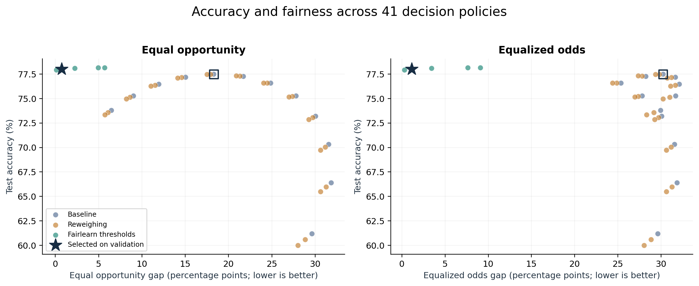

# Credit Scoring Fairness Audit

A Big Data project that audits loan approval decisions on **2,000,000 synthetic applications** using Apache Spark and Fairlearn. It compares a baseline logistic regression model with training reweighing and Fairlearn threshold optimization.

## Results

The selected policy increased held-out accuracy from **77.49% to 78.02%** and reduced the equal opportunity gap from **18.29 to 0.73 percentage points**.

| Policy | Test accuracy | Equal opportunity gap | Equalized odds gap |
| --- | ---: | ---: | ---: |
| Baseline | 77.49% | 18.29 pp | 30.22 pp |
| Reweighing | 77.49% | 17.93 pp | 29.79 pp |
| Threshold optimizer, tolerance 0.05 | 78.17% | 4.94 pp | 7.64 pp |
| **Selected threshold policy, tolerance 0.01** | **78.02%** | **0.73 pp** | **1.14 pp** |

Policy selection used validation data. The audit selected the highest-accuracy eligible policy with a validation equal opportunity gap of at most 2 percentage points and an approval rate between 20% and 90%. The final evaluation used 399,234 held-out applications. See the [run manifest](results/run_manifest.json) and [policy metrics](results/metrics.csv).



Equal opportunity compares approval rates across groups among applicants who would repay. Equalized odds also accounts for approval rates among applicants who would default. The [group error rates](plots/group_error_rates.png) and [validation selection plot](plots/validation_policy_selection.png) show how the selected policy changes both outcomes.

## Deliverables

| Deliverable | Location |
| --- | --- |
| Audit report | [PDF](docs/Credit_Scoring_Fairness_Audit_Report.pdf) |
| Model card | [PDF](docs/Model_Card.pdf) · [Markdown](MODEL_CARD.md) |
| Spark and Fairlearn pipeline | [audit.py](audit.py) · [fairness_core.py](fairness_core.py) |
| Self-contained notebook | [Credit_Scoring_Fairness_Audit.ipynb](Credit_Scoring_Fairness_Audit.ipynb) |
| Trade-off and group plots | [PNG and PDF figures](plots/) |
| Run evidence and trained models | [Results directory](results/) · [Run log](results/run.log) · [Verification summary](results/verification_summary.json) |
| Numerical checks | [Unit tests](tests/test_core.py) |
| Submission archive | [Download from the v1.0.0 release](https://github.com/Kundhan73/credit-scoring-fairness-audit/releases/tag/v1.0.0) |

## Run the audit

Use **Python 3.11 or 3.12** and **Java 17**. Activate your Java 17 installation before starting Spark.

```bash
python3.12 -m venv .venv
source .venv/bin/activate
python -m pip install -r requirements.txt
export SPARK_LOCAL_IP=127.0.0.1
export PYSPARK_PYTHON="$(command -v python)"

python -m unittest discover -s tests -v
python audit.py --rows 20000 --out smoke
```

The smoke run exercises both mitigation methods on 20,000 rows. To reproduce the submitted scale and regenerate the artifacts, run the following commands from the repository root.

```bash
python audit.py --rows 2000000 --out results
python make_deliverables.py
```

The full run writes measurements and model artifacts to `results/`. The generator writes figures to `plots/` and a fresh report, model card, and submission ZIP to `outputs/`. For Colab, download the notebook from the repository, upload it to Colab, and run its cells in order.

## Data and scope

Spark generates the full synthetic dataset from seed 327. The [sample CSV](results/sample_applications.csv) contains 1,000 generated applications. A positive label means the applicant would repay, and a positive model decision means approve. The two audit groups are fictional. The model card documents the limits of using these results for lending decisions.
